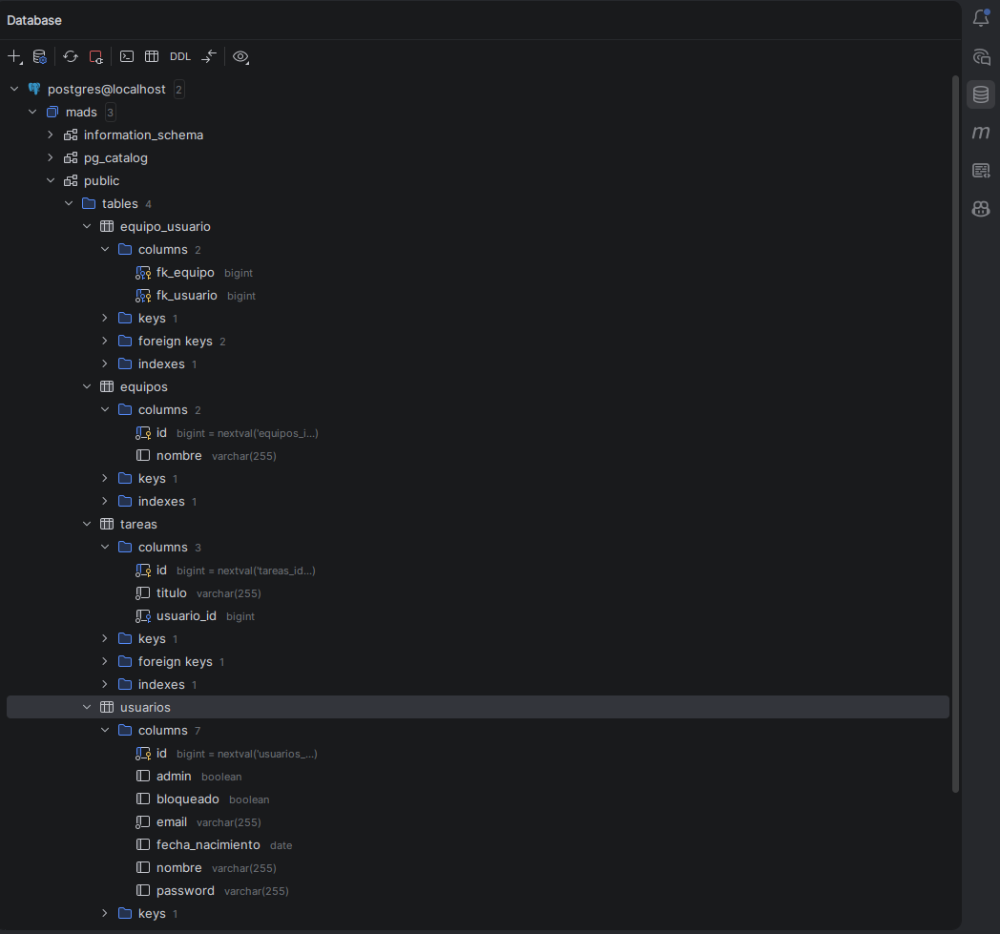

# Práctica 3: Documentación técnica de la Aplicación TodoList (v1.2.0)

---
## 1. Introducción

En esta práctica se han ampliado las funcionalidades de la aplicación TodoList con la gestión de equipos. Concretamente, se han implementado las historias de usuario 009 ("Gestionar pertenencia al equipo") y 010 ("Gestión de Equipos (Admin)"), haciendo uso de la arquitectura por capas (Modelo, Repositorio, Servicio, Controlador y Vistas Thymeleaf), TDD y el flujo de trabajo con Git/GitHub.

## 2. Base de datos PostgreSQL

A continuación se muestra el esquema de la base de datos en desarrollo PostgreSQL tras la implementación de las dos historias:


Como se puede observar, se han añadido las tablas `equipos` y `equipo_usuario`. Esta última actúa como tabla intermedia para la relación **ManyToMany** entre `Usuario` y `Equipo`. Además, se mantienen las tablas `usuarios` y `tareas` del proyecto base.

## 3. Historia de Usuario 009: Gestionar pertenencia al equipo

Esta historia permite a cualquier usuario autenticado crear nuevos equipos, unirse y salirse de ellos.

### 3.1. Rutas (endpoints) y controlador

En `madstodolist.controller.EquipoController` se han añadido los siguientes endpoints:

| Método | Ruta | Acción | Protección |
| --- | --- | --- | --- |
| `GET` | `/equipos/nuevo` | Muestra el formulario para crear un nuevo equipo. | Usuario logueado (`comprobarUsuarioLogeado()`) |
| `POST` | `/equipos/nuevo` | Crea un equipo a partir de los datos del formulario. Redirige a `/equipos` con mensaje flash. | Usuario logueado |
| `POST` | `/equipos/{id}/unirse` | Añade el usuario logueado al equipo indicado. | Usuario logueado |
| `POST` | `/equipos/{id}/salir` | Elimina el usuario logueado del equipo indicado. | Usuario logueado |

### 3.2. Clases, métodos

- **Modelo Equipo**: Se ha ampliado con el método `removeUsuario(Usuario usuario)` para mantener la coherencia de la relación bidireccional con `Usuario`. También se conserva `addUsuario(Usuario usuario)`.
- **Servicio EquipoService**: Se ha añadido `eliminarUsuarioDeEquipo(Long idEquipo, Long idUsuario)`, además de reforzar `crearEquipo(String nombre)` con validación para evitar nombres vacíos o `null`, lanzando `EquipoServiceException` en caso contrario.
- **Excepciones**: Se sigue utilizando `EquipoServiceException` para errores de negocio y `UsuarioNoLogeadoException` para peticiones sin sesión iniciada.

### 3.3. Plantillas Thymeleaf

- **formNuevoEquipo.html**: Formulario con `th:object="${equipoData}"` y `th:field="*{nombre}"` para dar de alta un nuevo equipo.
- **detalleEquipo.html**: Muestra los miembros del equipo. Mediante `th:if="${!miembros.contains(usuario)}"` y `th:if="${miembros.contains(usuario)}"` se renderizan, respectivamente, los botones "Unirme a este equipo" o "Salir del equipo", apuntando a las rutas `/equipos/{id}/unirse` y `/equipos/{id}/salir`.
- **listaEquipos.html**: Se ha añadido el enlace "Nuevo equipo" hacia `/equipos/nuevo`.

### 3.4. Tests

En `EquipoServiceTest` se han cubierto los casos de unirse/abandonar equipo, validación de nombre vacío y recuperación de equipos de un usuario. En `EquipoWebTest` se comprueba que las peticiones `POST` redirigen correctamente y que el controlador invoca a los métodos del servicio mediante `verify()`.

## 4. Historia de Usuario 010: Gestión de Equipos (Admin)

Esta historia otorga al administrador la capacidad de modificar el nombre de un equipo y eliminarlo por completo, siempre con las medidas de seguridad correspondientes.

### 4.1. Rutas (endpoints) y controlador

Se han añadido las siguientes rutas, todas protegidas con `comprobarAdministrador()`:

| Método | Ruta | Acción | Protección |
| --- | --- | --- | --- |
| `GET` | `/equipos/{id}/editar` | Muestra el formulario de edición con los datos del equipo. | Solo administrador |
| `POST` | `/equipos/{id}/editar` | Modifica el nombre del equipo mediante `modificarEquipo`. Redirige a `/equipos` con mensaje flash. | Solo administrador |
| `DELETE` | `/equipos/{id}` | Elimina el equipo tras desvincular a todos sus miembros. Devuelve respuesta vacía para ser consumida por AJAX. | Solo administrador |

### 4.2. Clases, métodos

- **Servicio EquipoService**: Se han implementado `modificarEquipo(Long idEquipo, String nuevoNombre)` con validación de nombre y `borrarEquipo(Long idEquipo)`. En `borrarEquipo` se recorre una copia del `Set<Usuario>` de `equipo.getUsuarios()` y se llama a `equipo.removeUsuario(u)` para romper correctamente la relación bidireccional antes de invocar a `equipoRepository.delete(equipo)`.
- **Seguridad**: `EquipoController` dispone del método `comprobarAdministrador()`, que lanza `UsuarioNoAutorizadoException` (anotada con `@ResponseStatus(HttpStatus.UNAUTHORIZED)`) si no hay usuario logueado o si este no tiene el atributo `admin = true`.
- **Excepciones**: Se reutiliza `EquipoServiceException` ante IDs inexistentes o datos inválidos.

### 4.3. Plantillas Thymeleaf

- **formEditarEquipo.html**: Formulario independiente para la edición. Usa `th:object="${equipoData}"`, `th:field="*{nombre}"` y envía la petición por `POST` a `/equipos/{id}/editar`. El botón "Cancelar" vuelve al listado `/equipos`.
- **listaEquipos.html**: Se ha añadido una columna condicional `th:if="${usuario.admin}"` con los botones "Editar" (enlace a `/equipos/{id}/editar`) y "Borrar" (botón que invoca la función JavaScript `delEquipo`). También se muestra el mensaje flash con `th:if="${mensaje}"`.

### 4.4. Tests

En `EquipoWebTest` se han añadido tests específicos para el rol administrador: acceso al formulario de edición, edición con `POST` verificando con `ArgumentCaptor` y `assertThat` que `modificarEquipo` recibe el `id` y el nuevo nombre correctos, y borrado con `DELETE` verificando que se invoca a `borrarEquipo`. Además se comprueba el comportamiento ante usuarios no administradores devolviendo `401 UNAUTHORIZED`.

## 5. Fragmentos de código interesantes
```java
@DeleteMapping("/equipos/{id}")
    @ResponseBody
    public String borrarEquipo(@PathVariable(value = "id") Long idEquipo) {
        comprobarAdministrador();
        equipoService.borrarEquipo(idEquipo);
        return "";
    }
```
El botón "Borrar" de listaEquipos.html hace un fetch con method: 'DELETE'. Con @ResponseBody y ResponseEntity<Void> se devuelve un 200 OK vacío, evitando que Thymeleaf intente resolver una vista. El JavaScript se encarga de recargar la página con location.reload().